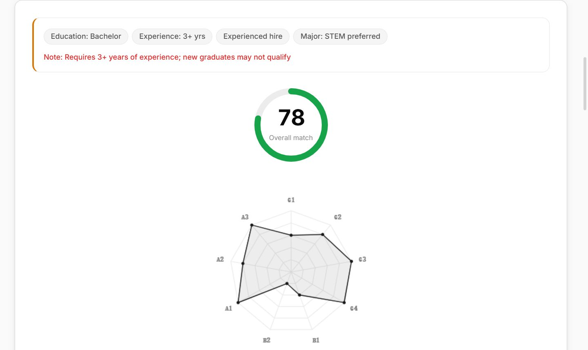
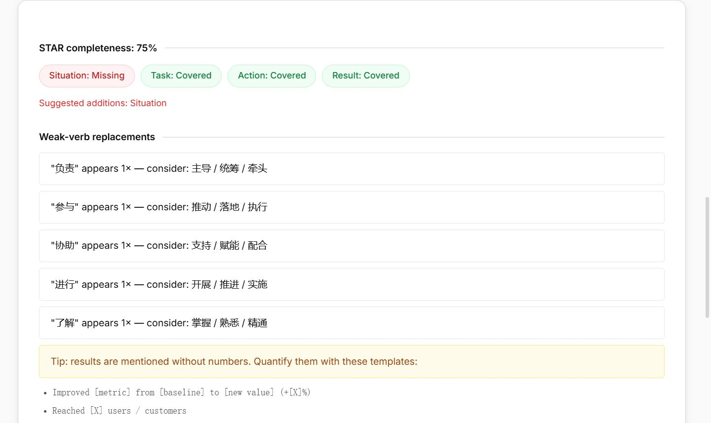
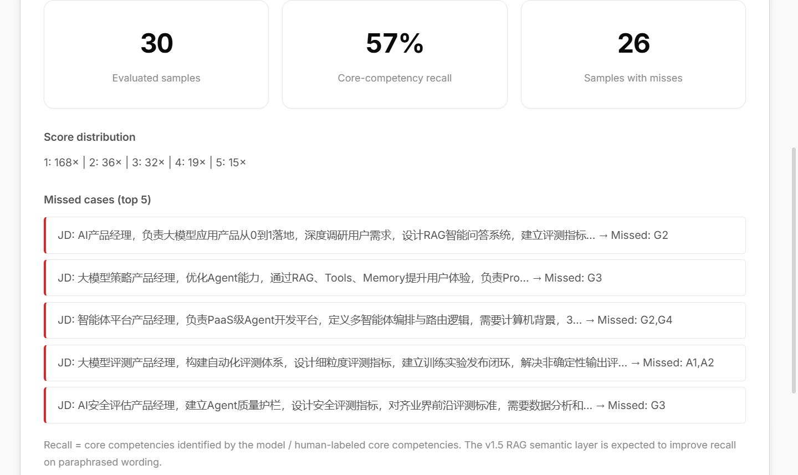
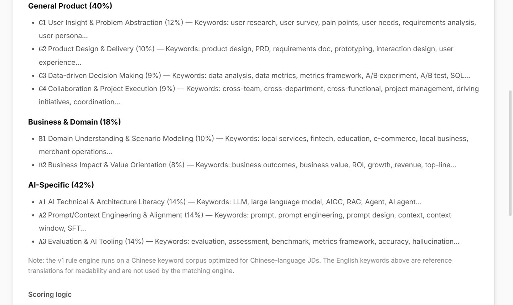

# JD Lens

> Read the JD. See the fit.

A **job-description match analyzer and resume optimizer** for aspiring AI Product Managers. Paste a JD and get a 0–100 match score across 9 competency dimensions; paste your resume experience and get actionable feedback on STAR completeness, weak verbs, quantification, and ATS keyword coverage.

**Bilingual UI (Chinese / English) with one-click switching. No backend, no API keys — your data never leaves the browser.**

[](https://github.com/Shuyi-CH/career-kit/actions/workflows/ci.yml)

## Live demo

👉 https://shuyi-ch.github.io/career-kit/

No sign-up required. All analysis runs locally in the browser, and history is stored only in `localStorage`.

## Product tour

**Job Match** — overall 0–100 score, hard-threshold risk flags, and a 9-axis competency radar:



**Resume** — STAR completeness, weak-verb replacements, and quantification templates:



**Evaluation** — the 30-JD test set run, with the 57% recall baseline kept fully visible:



**Model** — every competency, weight, and keyword corpus disclosed for auditing:



## Features

| Module | What it does |
|---|---|
| Job Match | Parses a JD and produces a 0–100 overall match score, per-competency scores across 9 items, a radar chart, strength/gap lists, and risk flags for four hard thresholds: education, major, years of experience, and campus vs. experienced hiring |
| Resume | Parses PDF / DOCX files locally or accepts pasted text; checks STAR completeness, replaces weak verbs (e.g. "responsible for" → "led / owned / drove"), suggests quantification templates, and computes ATS keyword coverage against an optional target JD |
| Evaluation | Runs a built-in test set of 30 public JDs with human-labeled ground truth to measure recall and score distribution — quantifying the model's own limitations |
| Model | Fully discloses the model structure, weights, scoring rules, and roadmap so every score is explainable and auditable |

## Quick start

There is no build step and no npm dependency. Clone the repo and serve it with any static file server:

```bash
git clone https://github.com/Shuyi-CH/career-kit.git
cd career-kit

# either one works
python -m http.server 8000
npx serve .
```

Then open `http://localhost:8000`. Opening `index.html` directly via `file://` also works, but a static server is recommended because browser policies may block the PDF.js web worker on the `file://` protocol.

## Tests

The scoring engine, resume optimizer, and model invariants are covered by 13 zero-dependency tests on Node's built-in test runner:

```bash
npm test          # equivalent to: node --test
```

## Project structure

```
career-kit/
├── index.html              # Single-page app, 4 tabs
├── favicon.svg             # Brand icon (lens mark)
├── package.json            # Test script metadata; no runtime dependencies
├── .github/workflows/
│   └── ci.yml              # GitHub Actions: node --test on every push/PR
├── assets/
│   ├── og-cover.png        # Social share card (1200×630)
│   └── screenshots/        # Product tour images used in this README
├── css/
│   └── style.css           # shadcn-style design tokens and all styles
└── js/
    ├── i18n.js             # ZH/EN dictionaries and language switcher (persisted in localStorage)
    ├── competency-model.js # Competency model (single source of truth, frozen; bilingual display names)
    ├── scoring-engine.js   # Rule-based scoring engine (depends strictly on the model, no hardcoded items)
    ├── resume-optimizer.js # STAR check / weak verbs / quantification / ATS coverage
    └── app.js              # UI logic, canvas radar chart, file parsing, evaluation set
```

Tests live in `tests/engine.test.js`, which loads the same browser scripts as the app — no duplicated logic, no mocks of the engine.

## Architecture & privacy

- **Vanilla HTML / CSS / JavaScript** — no framework, no bundler; five JS files loaded in dependency order
- **Homegrown single-page i18n**: static copy is marked with `data-i18n` attributes, dynamic copy goes through a `t()` dictionary function, and the engines return language-neutral error/warning codes instead of UI strings
- **PDF.js 3.11.174** (PDF text extraction) and **mammoth.js 1.6.0** (DOCX text extraction) are loaded via CDN; all parsing happens on-device
- Analysis history and language preference are persisted in `localStorage` with zero network reporting
- No JD or resume content is ever collected or uploaded — clearing browser data deletes everything

## Scoring model

### Sources

The model is built from two public references:

1. Woshipm.com, *"Analysis of 54 AI PM JDs from leading companies"* — 14 companies including ByteDance, Tencent, Ant Group, OpenAI, and Anthropic; 5 general capability dimensions and 6 AI-specific capabilities
2. The TripAdvisor Product Competency Framework by Ravi Mehta — a widely adopted 12-item MECE framework

### Model structure: 9 items in 3 layers, weights summing to 100

| Layer | ID | Competency | Weight |
|---|---|---|---|
| General Product (40%) | G1 | User Insight & Problem Abstraction | 12 |
| | G2 | Product Design & Delivery | 10 |
| | G3 | Data-driven Decision Making | 9 |
| | G4 | Collaboration & Project Execution | 9 |
| Business & Domain (18%) | B1 | Domain Understanding & Scenario Modeling | 10 |
| | B2 | Business Impact & Value Orientation | 8 |
| AI-Specific (42%) | A1 | AI Technical & Architecture Literacy | 14 |
| | A2 | Prompt/Context Engineering & Alignment | 14 |
| | A3 | Evaluation & AI Tooling | 14 |

A separate **hard-threshold module** (education, major, years of experience, campus/social hiring) is kept out of the weighted score and only surfaces pass/risk flags — so screening criteria such as "Master's degree required" are never conflated with competency scoring.

### Per-item scoring rule

Each item uses a two-level rule combining keyword hits and intensity words:

| Keywords matched | No intensity word | With intensity words ("led", "end-to-end", "0-to-1", etc.) |
|---|---|---|
| 0 | 1 | 1 |
| 1 | 2 | 3 |
| 2 | 3 | 4 |
| ≥ 3 | 4 | 5 |

Item scores (1–5) are weighted and normalized into a 0–100 overall match. All rules are defined as data structures in `competency-model.js`; the engine contains no hardcoded competency items.

## Evaluation baseline & known limitations

On the 30-JD test set with human-labeled core competencies as ground truth, the current rule engine (v1) achieves:

- **57% core-competency recall** — 26 of the 30 samples contain at least one missed item
- Main cause of misses: keyword matching cannot understand paraphrasing (e.g. a JD says "leveraged customer resources" while the dictionary only contains "user research")

This number is **deliberately kept as a visible baseline** rather than hidden. v1.5 adds a semantic retrieval layer and will run an A/B comparison on the same test set to demonstrate real recall improvement.

Other known boundaries:

- JDs shorter than 30 characters are rejected to prevent misleading scores on fragmentary text
- Only `.pdf` / `.docx` are supported; legacy `.doc` is outside mammoth.js's support range
- Scanned or phone-photo PDFs have no text layer and cannot be read by any text-extraction tool (local OCR is planned for v2)
- Scores are a **reference signal** for job-search preparation, not a prediction of hiring probability
- The v1 engine matches Chinese-language JDs; the English keyword lists in the Model tab are reference translations for readability and are not used by the matching engine

## Roadmap

- **v1 (current):** rule-engine scoring, resume optimization, 30-JD evaluation baseline
- **v1.5:** in-browser embeddings via Transformers.js (`Xenova/paraphrase-multilingual-MiniLM-L12-v2`, ~120 MB local model) powering a RAG semantic retrieval layer for paraphrased wording, with A/B recall comparison on the same test set
- **v2:** local OCR for scanned/image PDFs via Tesseract.js; LLM-powered free-form resume rewriting and JD understanding

## Disclaimer

This is a personal product/engineering practice project. The model and scoring rules are provided for job-search reference only and do not represent the actual hiring criteria of any company.
